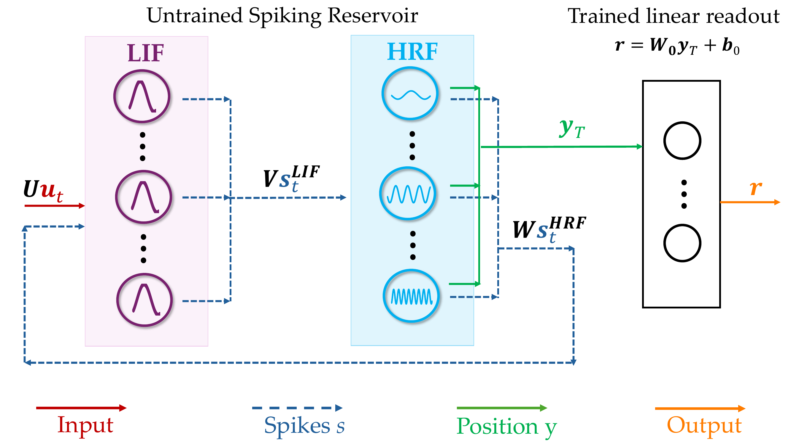

# HRF-Res: Frequency-Selective Spiking Reservoirs with Resonant Neurons

[](https://arxiv.org/abs/2610.37906)
[](https://neurips.cc/)
[](LICENSE)
[](requirements.txt)
[](https://pytorch.org/)

Code for **[Beyond Low-Pass Dynamics: Frequency-Selective Spiking Reservoirs
with Resonant Neurons](https://arxiv.org/abs/2610.37906)**, Aurora Micheli,
Claudio Gallicchio, Nergis Tomen, NeurIPS 2026.

HRF-Res is a liquid state machine in which a LIF encoder drives a reservoir of
Harmonic Resonate-and-Fire (HRF) neurons. Unlike leaky integrate-and-fire
neurons, which act as low-pass filters, HRF neurons oscillate and respond
selectively to input frequencies, so the reservoir behaves like a bank of
band-pass filters. All weights are random and fixed; only a linear readout is
trained.

<p align="center">
  
</p>

This repository contains the model, the LIF-Res and RON baselines, and the
configurations behind every result in the paper.

## Installation

The code was developed and tested with Python 3.7 and the package versions in
`requirements.txt`:

```bash
pip install -r requirements.txt
```

A CUDA GPU is recommended for the larger reservoirs (N = 3000 and above).

## Quick start

```python
import torch
from hrf_res.models import HRFRes

model = HRFRes(n_inp=1, n_hid=800, dt=0.042,
               gamma=2.7, gamma_range=2.0, epsilon=0.08, epsilon_range=1.0,
               rho=0.99, input_scaling=2.0, theta_lif=0.05, theta_hrf=0.005,
               readout_mode="final")

x = torch.rand(32, 784, 1)        # (batch, time steps, input channels)
features, rates = model(x)        # features: (32, 800); rates: mean firing rates
```

The features can be fed to any linear classifier; `hrf_res.readout.fit_readout`
reproduces the logistic-regression readout used in the paper.

## Data

All datasets go into one folder (`data/` by default, or `--data_dir`):

| Dataset | Source | Expected location |
|---|---|---|
| sMNIST, psMNIST, npCIFAR-10 | downloaded automatically by torchvision | `data/MNIST/`, `data/cifar-10-batches-py/` |
| FordA, FordB, Wafer, Earthquakes | [UCR archive](https://www.timeseriesclassification.com/) | `data/FordA/FordA_TRAIN.tsv`, `FordA_TEST.tsv`, ... |
| SHD | [Zenke Lab](https://zenkelab.org/datasets/) (`shd_train.h5.gz`, `shd_test.h5.gz`, unzipped) | `data/SHD/shd_train.h5`, `shd_test.h5` |
| DVS Gesture, N-MNIST | downloaded by [tonic](https://tonic.readthedocs.io/) | `data/DVSGesture/`, `data/NMNIST/` |

## Reproducing the paper

Every result has a config in `configs/`. Each run uses five reservoirs drawn
with seeds `seed, seed + 1, ...` and writes its results to `outputs/`.

**Tables 1-3 and Fig. 4** (classification accuracy and energy):

```bash
python scripts/train.py configs/table1/smnist_hrf_res.yaml
python scripts/train.py configs/table1/smnist_lif_res.yaml
...
python scripts/train.py configs/fig4/forda.yaml      # all six readouts on the same reservoirs
```

| Folder | Paper |
|---|---|
| `configs/table1/` | Table 1: HRF-Res vs LIF-Res |
| `configs/table2/` | Table 2: HRF-Res vs RON (the sMNIST and FordA HRF-Res runs are the Table 1 configs) |
| `configs/table3/` | Table 3: comparison with spiking reservoir baselines |
| `configs/fig4/` | Fig. 4: readout strategy ablation |

Energy is estimated with the model of Sec. 3.3 and saved with every run; the
neuron state-update energy of the appendix is given by
`hrf_res.energy.state_update_energy`.

**Figs. 2-3 and Appendix B** (frequency selectivity and CKA):

```bash
python scripts/characterise.py configs/characterisation/forda.yaml                 # Figs. 2-3
python scripts/characterise.py configs/characterisation/forda.yaml --hann          # Hann-window table
python scripts/characterise.py configs/characterisation/forda.yaml --skip sweep \
    --cka_sizes 100 200 500 1000 0 --washout 0 0.1 0.25 0.5                         # CKA control tables
```

**Appendix C** (robustness to noise and sampling-rate shifts):

```bash
python scripts/robustness.py configs/robustness/forda_hrf_res.yaml
```

**Figures** (after the runs above):

```bash
python scripts/make_figures.py      # writes figures/bandpass_summary, repr_analysis_combined, readout_ablation
```

**Hyperparameter search** (Appendix A): random search on a 10% validation
split of the training set, with the ranges of the appendix tables:

```bash
python scripts/search.py configs/search/forda_hrf_res.yaml
python scripts/train.py outputs/search/forda_hrf_res_best.yaml
```

Results obtained with these scripts match the paper up to the variability
across random reservoirs.

## Repository structure

```
hrf_res/
  models.py     HRF-Res, LIF-Res and RON
  data.py       dataset loaders
  readout.py    feature extraction and logistic-regression readout
  energy.py     energy model
  utils.py      seeding and model construction from a config
scripts/        train, characterise, robustness, search, make_figures
configs/        one YAML file per experiment
```

## Citation

```bibtex
@inproceedings{micheli2026beyond,
  title     = {Beyond Low-Pass Dynamics: Frequency-Selective Spiking Reservoirs with Resonant Neurons},
  author    = {Micheli, Aurora and Gallicchio, Claudio and Tomen, Nergis},
  booktitle = {Advances in Neural Information Processing Systems},
  year      = {2026},
  eprint    = {2610.37906},
  archivePrefix = {arXiv}
}
```

## Acknowledgements

This code builds on the implementations of the Randomized Oscillators Network
(Ceni et al., 2024) and coRNN (Rusch & Mishra, 2021).
